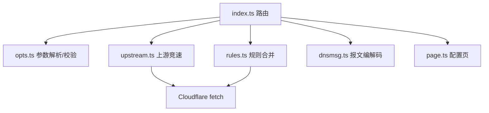

# System architecture

## Overview

Cloudflare Worker 单文件部署（无构建、无外部依赖），五层：

| 模块 | 职责 |
|---|---|
| `src/index.ts` | 路由与响应编排：wire（`/dns-query`、`/p/…`、POST）、JSON 调试 API（`/?name=`）、配置页（`GET /`）、边缘缓存接线 |
| `src/opts.ts` | 每请求 URL 配置参数（block/allow/host/bm/up/list）的解析、安全校验、规范化与 `optsHash`；页面与 worker 共用同一编解码（见 [[stateless-config-model]]） |
| `src/rules.ts` | 规则集：env 部署级（BLOCK_DOMAINS/BLOCKLIST_URL，isolate 6h 缓存）与 URL 参数并集合并；`isBlocked` 域名后缀/订阅正则匹配，`lookupFixed` 返回 A/AAAA/CNAME 固定应答；远程 list 拉取走 isolate 10 分钟缓存 |
| `src/upstream.ts` | 上游 DoH 竞速与 sticky 最快选择；`up` 参数覆盖时不粘滞；JSON 路径把 `/dns-query` 映射到 `/resolve` |
| `src/dnsmsg.ts` | RFC 1035 报文编解码：parseQuestion/buildReply（A/AAAA/CNAME 应答）/minAnswerTtl（纯函数，单测覆盖） |
| `src/page.ts` | 配置页 HTML（内联 JS，无框架），只负责拼参数生成 URL，不写存储 |

## Module graph

## Constraints

- Workers runtime 限制：无 Node API、内存态全部是 isolate 局部（规则/列表/sticky 缓存在冷启动后重建，可接受）。
- 边缘缓存（`caches.default`）是**多租户共享**的：cacheKey 必须包含 `optsHash` 分区，否则带配置请求会污染/被污染全局条目（已实测隔离正确）。
- 无鉴权 + URL 携带配置 ⇒ 任何触发 worker 外发的参数必须硬校验（https、禁 IP/内网名、禁 query 注入、条目上限）。
- Response body 单次可读：入缓存必须 `clone()`（历史 bug，已修）。
- 兼容 RFC 8484：GET `?dns=` 与 POST `application/dns-message`；部分上游只支持 GET，POST 失败自动回退。
