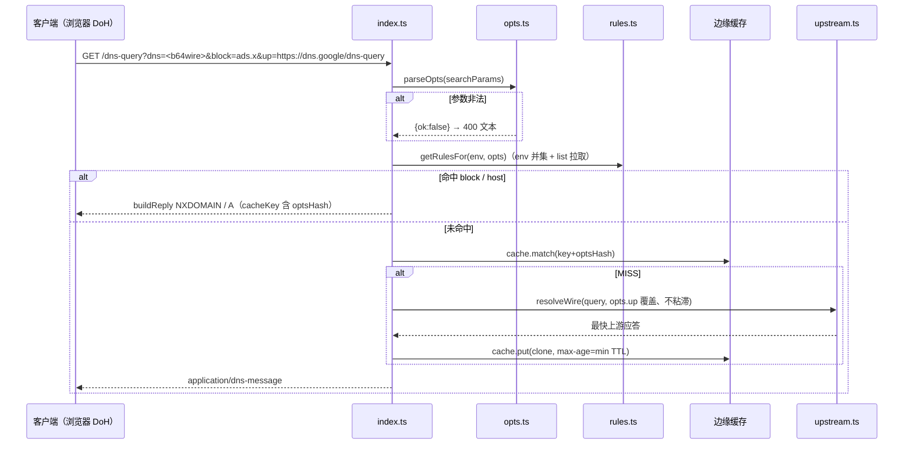

# Key flows

## 带配置参数的 wire 查询（主路径）

## 配置页（GET /）

浏览器 `GET /` → `page.ts` 返回内联 HTML；表单输入 block/host/up/list 时前端用 `optsToParams` 同规则拼
`/dns-query?...` 与 `/p/<base64url("?config")>` 两种 URL 供复制；「在线测试」按钮 fetch `/?name=…`（JSON 路径，同样吃配置参数）。服务端无写入、无状态。

## /p/ 路径形式

- `/p/<b64url("?block=…")>` + `?dns=` 或 POST body：配置在路径、查询在别处。
- `/p/<b64url("<wire-b64url>|?config")>`：纯路径请求（`|` 分隔，因 `?`/`&` 会被 URL 层吃掉）。
